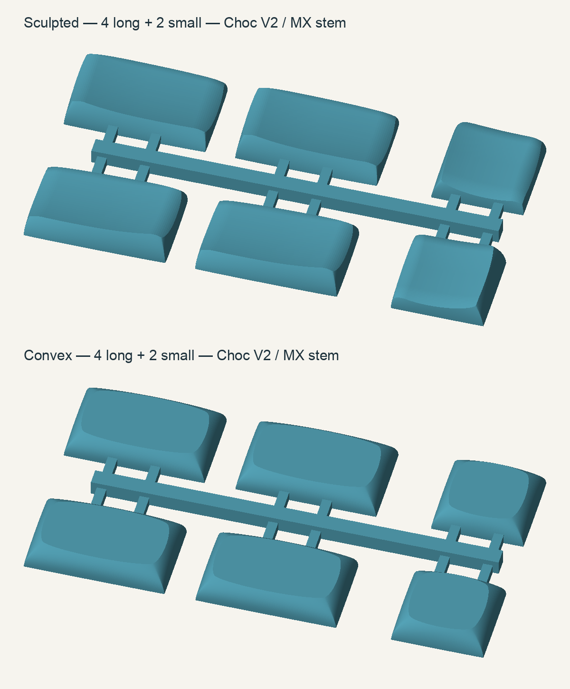

# Endgame Choc V2 thumb caps — two connected sets

Two separate 2 × 3 grids, each containing **four long (1.5u) and two small (1u) caps**:

| Upload file | Quantity for one keyboard's trial set | Overall STL dimensions |
| --- | --- | --- |
| `upload/Endgame-sculpted-thumbs-4long-2small-grid.stl` | 1 | 86.04 × 44.10 × 6.05 mm |
| `upload/Endgame-convex-thumbs-4long-2small-grid.stl` | 1 | 85.80 × 44.10 × 5.71 mm |

Ordering one of each gives **12 caps total**, enough to try either profile on one keyboard. These have **MX-style cross sockets for Kailh Choc V2**; they do not fit Choc V1's two-prong mount. Long caps retain Choc spacing dimensions, not full-size 19.05 mm MX spacing.



## Ordering at JLC3DP

1. Extract the package and upload the **two STL files inside `upload`** separately to JLC3DP's 3D-printing service. The ZIP is a delivery bundle, not a PCB Gerber archive.
2. Use **millimetres, 100% scale, quantity 1 for each STL** for one set of each profile. Do not rescale the complete models to tune stem fit.
3. These files target professional resin/nylon printing. SLA resin offers a smooth surface; select the material and colour in the quote. Avoid painting/coating inside the stem sockets. Material suitability and thin-feature approval remain subject to JLC's review.
4. Suggested order note: “Six keycaps connected by a sacrificial carrier. Keep the carrier and all six caps together. Please preserve the MX cross socket dimensions and keep supports off the typing surfaces and socket interiors where possible.”
5. **First-print fit is untested.** The upstream nominal MX socket dimensions are retained; printer shrinkage, finish and switch variation can affect fit. Test one cap gently before fitting the rest. Do not force a tight socket onto a switch.

Both upload files are binary STL, approximately **14 MiB sculpted / 14 MiB convex**. Both have been reloaded and verified locally; neither has been submitted to JLC's quoting system.

### Connected-part policy

[JLC3DP's Connected Parts Printing Guide](https://jlc3dp.com/help/article/connected-parts-printing-guide), checked 2026-10-15, permits at most ten connected parts per file, requires a unified shell and connections thicker than 1.5 mm, and excludes WJP, BJ, FDM and SLM from connected-part printing. Each set has six caps, **twelve 1.8 × 1.8 mm cut gates**, and a **3 × 3 mm carrier spine**.

JLC generally discourages connecting parts already above its minimum size, so this arrangement still requires their approval. The guide lists an extra $0.10 per connected piece and an additional 1–2 business days; use their actual quote. Individual files are provided in `single-caps` if they require separate parts.

## Separating and installing

The gates join the lower outer skirts, away from the typing surfaces and central sockets. Support each cap while using flush cutters to cut its two gates; trim remaining nubs flush with the outside skirt. **Cut rather than twist or snap** the carrier away, especially with resin. Remove all residual protrusions before testing key travel.

The sculpted set contains two left long, two right long, one left small and one right small cap. The top row in the preview contains left variants; the bottom row contains right variants. The convex long caps are identical to each other, as are the two small convex caps.

| Keyboard position | Switch references | Sculpted singles if ordering separately | Convex singles if ordering separately |
| --- | --- | --- | --- |
| Left outer and inner long thumbs | SW5, SW19 | `sculpted-long-left.stl`, quantity 2 | `convex-long.stl`, quantity 2 |
| Left middle small thumb | SW15 | `sculpted-small-left.stl`, quantity 1 | `convex-small.stl`, quantity 1 |
| Right inner and outer long thumbs | SW23, SW37 | `sculpted-long-right.stl`, quantity 2 | `convex-long.stl`, quantity 2 |
| Right middle small thumb | SW27 | `sculpted-small-right.stl`, quantity 1 | `convex-small.stl`, quantity 1 |

Use the long axis across each 1.5u footprint. The supplied long sculpted cap geometry already includes the required 90° body rotation with the MX cross aligned to the footprint. References apply to the wired and nice!nano designs in this repository.

## Verification and limits

- All six single-cap variants and both connected grids are watertight, consistently oriented, positive-volume meshes, each with **one connected component**. See `validation/meshes.json` for dimensions and SHA-256 hashes.
- Conservative full-height rectangular envelopes around the actual cap bodies were compared with the wired and nice!nano case STEP models (and a since-removed XIAO case). They showed no intersections: at least about **0.73 mm case clearance for sculpted** and **0.90 mm for convex**. The tightest adjacent thumb-cap envelope gaps are about **0.46 mm sculpted / 0.70 mm convex**. These are nominal CAD checks, not tolerance guarantees.
- These case checks do not establish actual switch seating height, full key travel, print strength, or socket fit. Physical validation is still required. The first printed set is a prototype.
- The stem's nominal cross is 4.03 × 1.15 mm on one axis and 4.23 × 1.25 mm on the other, with a flared entry. Approximate centreline cavity depth is 2.78 mm sculpted and 3.65 mm convex. No global scaling or speculative printer compensation was applied.

## Source, changes and licence

Original Chicago Steno profile: [pseudoku/PseudoMakeMeKeyCapProfiles](https://github.com/pseudoku/PseudoMakeMeKeyCapProfiles), inspected at `e32c51a9de728657fe5e2cd3a7ba05e6ad4937b8`.

The actual parametric MX-stem source used here is [carrefinho/chicago-steno-choc-spc-mx-stem-openscad](https://github.com/carrefinho/chicago-steno-choc-spc-mx-stem-openscad), commit **`13fb2f1c1e0fa872f598abdff27029e327e86393`**, downstream of infused-kim and Pseudoku. Copied source and its supporting libraries are included in `source/vendor`. GPL-3.0 terms are included in `LICENSE`; retain attribution and the applicable source/licence when redistributing. The bundled scad-utils library retains its own licence.

The user's [Printables example by Duong Hoang](https://www.printables.com/model/1754989-cs-keycaps-mx-stem) was a reference for connected presentation, not a mesh source. These are custom six-cap grids.

Changes to the MX fork:

- Correct undefined `rotate(stemRot)` to `rotate([0,0,StemRot])` in both profiles.
- Restrict the legacy Choc two-prong stem bed to `Stem == Choc`; it produced an unwanted fragment and a hole when included alongside the MX mount. The MX cylinder joins the shell directly.
- Disable the sculpted profile's FDM side cuts for professional resin/nylon printing.
- Use sculpted keyIDs 2/3 and convex keyIDs 1/3, with correct long-cap orientation and mirrored sculpted variants.
- Add the two-row, three-column removable carrier. Remove four isolated, exactly zero-area facets introduced by binary-STL precision in the sculpted grid; the full solid remains intact. No mesh decimation or shape smoothing was applied. No changes to the keyboard PCB or case.

Rebuild with Python, NumPy, trimesh and OpenSCAD with CGAL and Manifold backends:

```sh
python source/build.py --openscad /path/to/openscad
python source/build.py --verify-only
python source/render_preview.py
```

The renderer additionally uses Pillow. On this Mac the temporary OpenSCAD 2026.10.11 x86_64 build was used with `--x86-64`. CGAL successfully resolves the inherited nonplanar profile caps during single-cap exports; the final mesh checks are authoritative. Source file `single.scad` selects the cap shape; `grid.scad` defines the carrier. The build removes only isolated components with exactly zero surface area and rechecks all final files.
